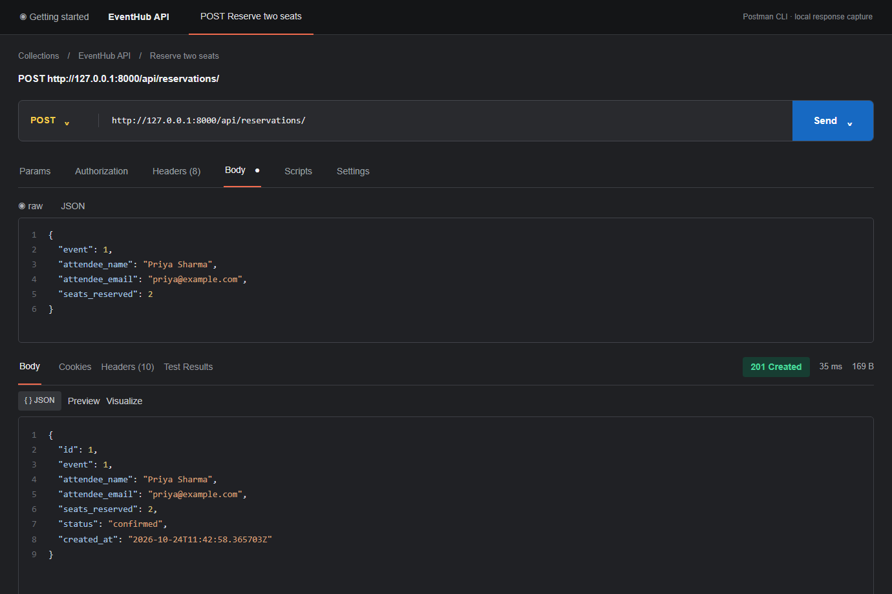
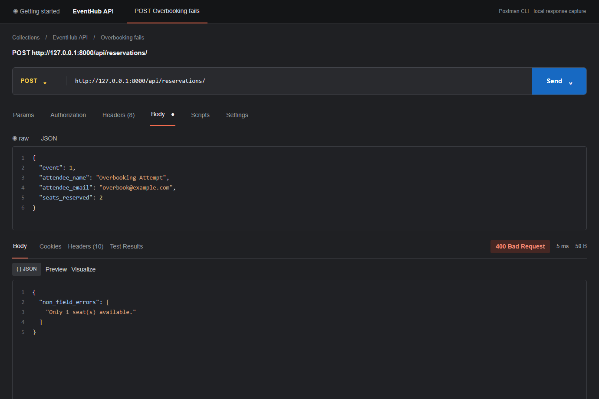
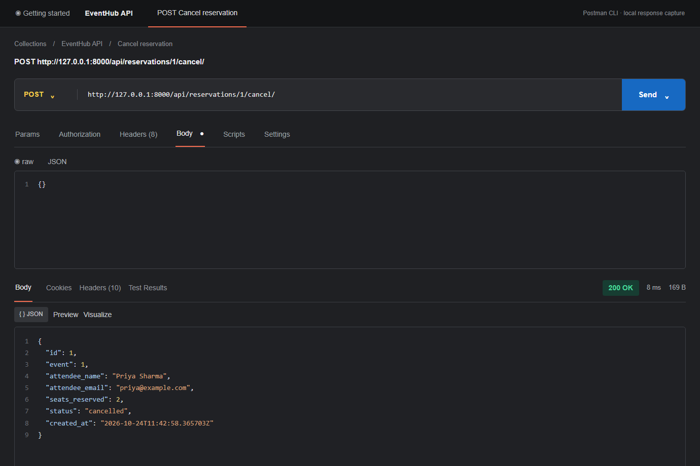

# EventHub

EventHub is a Django REST Framework API for browsing events, reserving seats, and cancelling reservations. It uses Django ORM models and SQLite for local development.

## Run locally

From this directory:

```powershell
py -m venv .venv
.venv\Scripts\Activate.ps1
pip install -r requirements.txt
python manage.py migrate
python manage.py runserver
```

The API is available at `http://127.0.0.1:8000/api/`. The first migration creates the event and reservation tables.

## Endpoints

| Method | Path | Behavior |
| --- | --- | --- |
| `GET`, `POST` | `/api/events/` | List events or create an event |
| `GET`, `PUT`, `PATCH`, `DELETE` | `/api/events/{id}/` | Retrieve, update, or delete an event |
| `GET` | `/api/events/?status=upcoming` | Filter events by status |
| `GET` | `/api/events/?venue=bangalore` | Case-insensitive venue search |
| `GET`, `POST` | `/api/reservations/` | List reservations or reserve seats |
| `GET`, `PUT`, `PATCH`, `DELETE` | `/api/reservations/{id}/` | Retrieve, edit, or remove a reservation |
| `POST` | `/api/reservations/{id}/cancel/` | Cancel a confirmed reservation and restore seats |
| `GET` | `/api/reservations/?event_id=1` | Filter reservations by event |

Create an event with `title`, `venue`, `date` (`YYYY-MM-DD`), `total_seats`, and `available_seats`. `status` is optional and defaults to `upcoming`. Responses include `reservations_count`, which counts confirmed reservations.

Create a reservation with `event`, `attendee_name`, `attendee_email`, and `seats_reserved`. Reservations require at least one seat and an upcoming or ongoing event. Requests for more seats than are available return `400 Bad Request`. Cancelling an already cancelled reservation also returns `400`.

## Postman

Import [postman_collection.json](postman_collection.json) into Postman Desktop. Its requests create an event, reserve seats, attempt an overbooking, cancel a reservation, and exercise the filters. The three response captures in [postman_screenshots/](postman_screenshots/README.md) show the results of running that collection with Postman CLI against the local API.

### Response captures







The captures show actual Postman CLI responses rendered in the same request/response layout as the reference screenshots. Postman Desktop closed when launched in this environment, so these are clearly labeled CLI captures rather than desktop window screenshots.

If Postman CLI is installed, run the collection with:

```powershell
postman collection run .\postman_collection.json --verbose
```

## Design decision

Seat changes use conditional database updates inside transactions. A reservation only decrements the event when the event is still reservable and has enough seats at write time, so simultaneous requests cannot both claim the last seat. Cancellation changes the reservation status conditionally and restores seats in the same transaction, preventing duplicate cancellation requests from returning the same seats twice.
